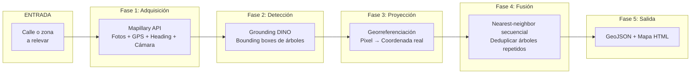
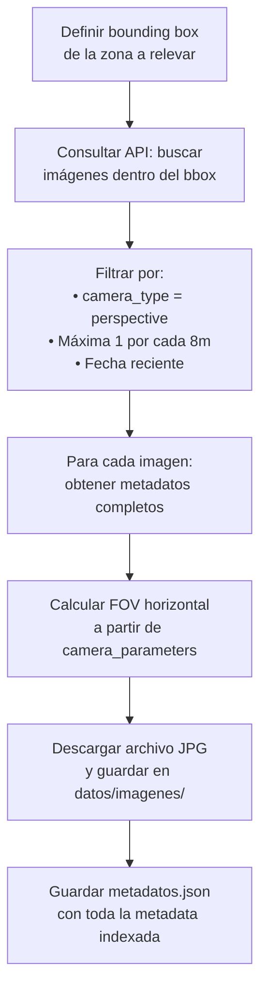
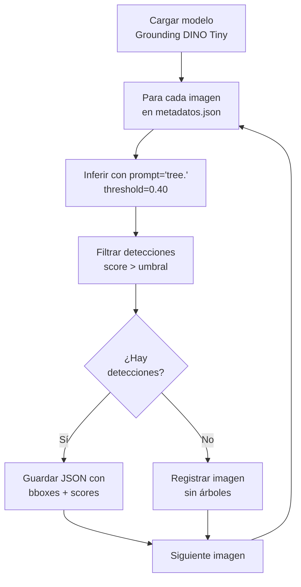
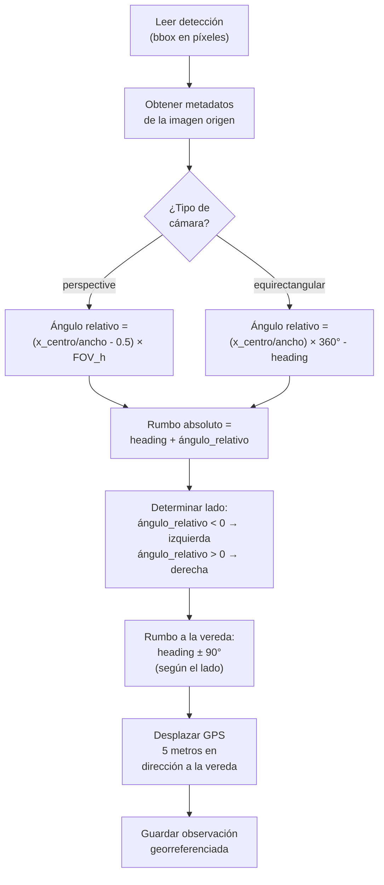
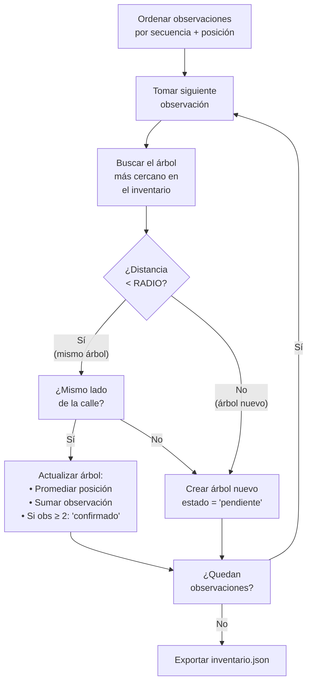

# Plan definitivo: Sistema de inventario de arbolado urbano

> Revisión: [PLAN_MAPEO.md](PLAN_MAPEO.md) contiene el plan actualizado de
> implementación, con asociación entre vistas y corrección de árboles agrupados.
> Este documento se conserva como base original; sus reglas de desplazamiento
> fijo y fusión por radio quedan reemplazadas por la propuesta revisada.

## Visión general



---

## Estructura de archivos del proyecto

```
agrotech/
├── config.yaml                    # Parámetros globales del sistema
├── requirements.txt               # Dependencias Python
│
├── 01_adquirir.py                 # Fase 1: Descargar fotos de Mapillary
├── 02_detectar.py                 # Fase 2: Detectar árboles (basado en detectar_arboles.py actual)
├── 03_proyectar.py                # Fase 3: Convertir detecciones a coordenadas geográficas
├── 04_fusionar.py                 # Fase 4: Deduplicar árboles entre imágenes
├── 05_exportar.py                 # Fase 5: Generar GeoJSON y mapa HTML
├── pipeline.py                    # Ejecutar todas las fases en secuencia
│
├── datos/
│   ├── imagenes/                  # Fotos descargadas de Mapillary
│   │   ├── seq_ABC123/            # Agrupadas por secuencia
│   │   │   ├── 000001.jpg
│   │   │   ├── 000002.jpg
│   │   │   └── ...
│   │   └── seq_DEF456/
│   ├── metadatos.json             # Metadatos de todas las imágenes (GPS, heading, cámara)
│   └── secuencias.json            # Índice de secuencias descargadas
│
├── resultados/
│   ├── detecciones/               # Salida de Fase 2 (un JSON por imagen)
│   │   ├── 000001.json
│   │   └── ...
│   ├── observaciones.json         # Salida de Fase 3 (detecciones georreferenciadas)
│   ├── inventario.json            # Salida de Fase 4 (árboles únicos deduplicados)
│   ├── arboles.geojson            # Salida de Fase 5 (mapa vectorial)
│   └── mapa.html                  # Salida de Fase 5 (mapa interactivo)
│
├── annotated_dataset/             # Dataset COCO existente (para validación)
│   ├── images/
│   └── coco_annotations.json
│
└── visualizar_coco.py             # Visor existente (sin cambios)
```

---

## Modelo de datos

Cada fase produce y consume datos con una estructura definida. Las fases se comunican mediante archivos JSON.

### Imagen (Fase 1 → Fase 2)

```json
{
  "id": "mapillary_image_id",
  "archivo": "datos/imagenes/seq_ABC123/000001.jpg",
  "secuencia": "ABC123",
  "orden_en_secuencia": 1,
  "lat": -34.6037,
  "lon": -58.3816,
  "heading": 135.2,
  "camera_type": "perspective",
  "camera_parameters": [0.842, -0.012, 0.003],
  "ancho": 2048,
  "alto": 1536,
  "fov_horizontal": 67.4,
  "timestamp": "2024-03-15T14:22:00Z"
}
```

### Detección (Fase 2 → Fase 3)

```json
{
  "id": "det_00001",
  "imagen_id": "mapillary_image_id",
  "bbox_xyxy": [820.0, 150.0, 1050.0, 980.0],
  "bbox_coco": [820.0, 150.0, 230.0, 830.0],
  "x_centro": 935.0,
  "y_centro": 565.0,
  "ancho_bbox": 230.0,
  "alto_bbox": 830.0,
  "score": 0.82,
  "etiqueta": "tree"
}
```

### Observación georreferenciada (Fase 3 → Fase 4)

```json
{
  "id": "obs_00001",
  "deteccion_id": "det_00001",
  "imagen_id": "mapillary_image_id",
  "secuencia": "ABC123",
  "orden_en_secuencia": 1,
  "lat_estimada": -34.60366,
  "lon_estimada": -58.38155,
  "lado": "derecha",
  "angulo_observacion": 158.7,
  "score": 0.82
}
```

### Árbol inventariado (Fase 4 → Fase 5)

```json
{
  "id": 42,
  "lat": -34.60367,
  "lon": -58.38156,
  "lado": "derecha",
  "estado": "confirmado",
  "num_observaciones": 3,
  "score_promedio": 0.79,
  "score_maximo": 0.88,
  "observaciones": ["obs_00001", "obs_00004", "obs_00009"],
  "imagenes": ["img_001", "img_002", "img_003"]
}
```

---

## Fase 1: Adquisición de imágenes

### Objetivo
Descargar imágenes de una calle o zona junto con sus metadatos geográficos y de cámara desde Mapillary API v4.

### Entrada
- Nombre de la calle o polígono geográfico (bounding box)
- Token de acceso de Mapillary

### Proceso detallado



#### 1.1 Buscar imágenes en la zona

```python
# Endpoint: GET https://graph.mapillary.com/images
# Parámetros:
#   bbox = "lon_min,lat_min,lon_max,lat_max"
#   fields = "id,geometry,computed_geometry,compass_angle,computed_compass_angle,
#             camera_type,camera_parameters,width,height,captured_at,sequence"
#   limit = 100  (máximo por página, paginar si hay más)

import requests

def buscar_imagenes(bbox, token):
    url = "https://graph.mapillary.com/images"
    params = {
        "bbox": f"{bbox['lon_min']},{bbox['lat_min']},{bbox['lon_max']},{bbox['lat_max']}",
        "fields": "id,computed_geometry,computed_compass_angle,compass_angle,"
                   "camera_type,camera_parameters,width,height,captured_at,sequence",
        "limit": 100,
    }
    headers = {"Authorization": f"OAuth {token}"}
    
    todas = []
    while url:
        resp = requests.get(url, params=params, headers=headers)
        data = resp.json()
        todas.extend(data["data"])
        url = data.get("paging", {}).get("next")
        params = None  # La URL de paginación ya incluye los params
    
    return todas
```

#### 1.2 Filtrar imágenes útiles

```python
def filtrar_imagenes(imagenes):
    """Conservar solo imágenes de perspectiva con metadatos completos."""
    filtradas = []
    for img in imagenes:
        # Requisito 1: Tipo de cámara soportado
        if img.get("camera_type") not in ("perspective", "equirectangular"):
            continue
        
        # Requisito 2: Tiene coordenadas refinadas
        if not img.get("computed_geometry"):
            continue
        
        # Requisito 3: Tiene orientación
        heading = img.get("computed_compass_angle") or img.get("compass_angle")
        if heading is None:
            continue
        
        filtradas.append(img)
    
    return filtradas
```

#### 1.3 Calcular FOV horizontal

> [!IMPORTANT]
> Este cálculo es crítico para la Fase 3. Un FOV incorrecto hace que el ángulo de observación sea erróneo y el árbol se proyecte en la vereda equivocada.

```python
import math

def calcular_fov(camera_type, camera_parameters, ancho, alto):
    """Calcula el campo de visión horizontal en grados."""
    
    if camera_type == "equirectangular":
        return 360.0  # Panorama completo
    
    if camera_type == "perspective":
        if not camera_parameters or len(camera_parameters) < 1:
            return 90.0  # Valor por defecto conservador
        
        f_normalizado = camera_parameters[0]
        dimension_max = max(ancho, alto)
        f_pixeles = f_normalizado * dimension_max
        
        fov_h_rad = 2 * math.atan(ancho / (2 * f_pixeles))
        return math.degrees(fov_h_rad)
    
    return None  # Tipo no soportado
```

#### 1.4 Descargar imagen

```python
def descargar_imagen(image_id, destino, token):
    """Descarga el archivo JPG de una imagen de Mapillary."""
    url = f"https://graph.mapillary.com/{image_id}?fields=thumb_2048_url"
    headers = {"Authorization": f"OAuth {token}"}
    resp = requests.get(url, headers=headers)
    thumb_url = resp.json()["thumb_2048_url"]
    
    img_resp = requests.get(thumb_url)
    destino.parent.mkdir(parents=True, exist_ok=True)
    destino.write_bytes(img_resp.content)
```

### Salida
- `datos/imagenes/seq_*/` — Imágenes JPG organizadas por secuencia
- `datos/metadatos.json` — Array de objetos con todos los campos calculados

---

## Fase 2: Detección de árboles

### Objetivo
Ejecutar Grounding DINO sobre cada imagen y registrar las bounding boxes de árboles detectados.

### Base
Reutilizar la lógica existente de [`detectar_arboles.py`](file:///home/rodrigo/Downloads/agrotech/detectar_arboles.py), adaptándola para:
- Leer las imágenes de `datos/imagenes/`
- Asociar cada detección con el `imagen_id` de Mapillary
- Calcular y guardar `x_centro`, `y_centro`, `ancho_bbox`, `alto_bbox`

### Proceso



### Cambios respecto al script actual

| Aspecto | `detectar_arboles.py` actual | Versión nueva |
|---|---|---|
| Entrada | Carpeta de imágenes sueltas | `datos/metadatos.json` como índice |
| Prompt | `tree.` (configurable) | `tree.` (igual) |
| Salida | JSON propio + imagen anotada PNG | Solo JSON estructurado con schema definido |
| Campos extra | — | `x_centro`, `y_centro`, `imagen_id` |
| Imagen anotada | Se genera siempre | Opcional (flag `--anotar`) para no llenar disco |

### Salida
- `resultados/detecciones/IMAGEN_ID.json` — Un archivo por imagen, con array de detecciones

---

## Fase 3: Proyección geográfica

### Objetivo
Convertir cada detección en píxeles a una **observación georreferenciada** con coordenadas lat/lon estimadas del árbol real.

### Proceso



### Código completo de la fase

```python
import math
import json

# ═══════════════════════════════════════════════════════
# PARÁMETROS (vienen de config.yaml)
# ═══════════════════════════════════════════════════════
DISTANCIA_VEREDA = 5.0  # metros desde el centro de la calle a la vereda

# ═══════════════════════════════════════════════════════
# GEOMETRÍA: Cálculo del ángulo de observación
# ═══════════════════════════════════════════════════════

def angulo_relativo_perspective(x_centro, ancho_imagen, fov_h_grados):
    """
    Para una cámara de perspectiva (pinhole), calcula el ángulo
    horizontal entre la dirección central de la cámara y el punto
    detectado.
    
    Retorna grados:
      - Negativo = a la izquierda del heading
      - Positivo = a la derecha del heading
    """
    # Posición normalizada: -0.5 (borde izq) a +0.5 (borde der)
    pos_normalizada = (x_centro / ancho_imagen) - 0.5
    
    # Para una cámara pinhole, la relación correcta usa arctan,
    # no una regla de tres lineal. Pero para FOV < 90° la diferencia
    # es menor al 5%, así que la aproximación lineal es aceptable
    # para esta aplicación.
    return pos_normalizada * fov_h_grados


def angulo_relativo_equirectangular(x_centro, ancho_imagen):
    """
    Para un panorama 360° equirectangular, x mapea linealmente
    al azimut. El píxel 0 corresponde a heading - 180° (detrás)
    y el píxel ancho/2 corresponde al heading (frente).
    
    Convención de Mapillary: heading apunta al centro horizontal.
    """
    # x=0 → -180°, x=ancho/2 → 0° (frente), x=ancho → +180°
    return (x_centro / ancho_imagen) * 360.0 - 180.0


# ═══════════════════════════════════════════════════════
# GEOMETRÍA: Desplazar un punto GPS
# ═══════════════════════════════════════════════════════

def desplazar_gps(lat, lon, rumbo_grados, distancia_metros):
    """
    Dado un punto GPS, lo desplaza una distancia (en metros)
    en la dirección indicada por el rumbo (grados desde el norte,
    sentido horario).
    
    Usa la fórmula de Vincenty simplificada (esfera).
    Para distancias < 100m el error es despreciable.
    """
    R = 6_371_000  # Radio de la Tierra en metros
    d = distancia_metros / R
    brng = math.radians(rumbo_grados)
    lat1 = math.radians(lat)
    lon1 = math.radians(lon)
    
    lat2 = math.asin(
        math.sin(lat1) * math.cos(d) +
        math.cos(lat1) * math.sin(d) * math.cos(brng)
    )
    lon2 = lon1 + math.atan2(
        math.sin(brng) * math.sin(d) * math.cos(lat1),
        math.cos(d) - math.sin(lat1) * math.sin(lat2)
    )
    return math.degrees(lat2), math.degrees(lon2)


# ═══════════════════════════════════════════════════════
# PROCESO PRINCIPAL
# ═══════════════════════════════════════════════════════

def proyectar_deteccion(deteccion, imagen_meta):
    """
    Convierte una detección en píxeles a una observación
    georreferenciada.
    
    Parámetros:
      deteccion:   dict con x_centro, score, etc.
      imagen_meta: dict con lat, lon, heading, camera_type, fov_horizontal
    
    Retorna:
      dict con lat_estimada, lon_estimada, lado, angulo_observacion, etc.
      None si el tipo de cámara no es soportado.
    """
    x_centro = deteccion["x_centro"]
    heading = imagen_meta["heading"]
    
    # ── Paso 1: Calcular ángulo relativo según tipo de cámara ──
    if imagen_meta["camera_type"] == "perspective":
        ang_rel = angulo_relativo_perspective(
            x_centro,
            imagen_meta["ancho"],
            imagen_meta["fov_horizontal"]
        )
    elif imagen_meta["camera_type"] == "equirectangular":
        ang_rel = angulo_relativo_equirectangular(
            x_centro,
            imagen_meta["ancho"]
        )
    else:
        return None
    
    # ── Paso 2: Rumbo absoluto hacia el árbol ──
    rumbo_arbol = (heading + ang_rel) % 360
    
    # ── Paso 3: Determinar lado de la calle ──
    #    Normalizar ángulo relativo a rango [-180, 180]
    ang_norm = ang_rel
    if ang_norm > 180:
        ang_norm -= 360
    if ang_norm < -180:
        ang_norm += 360
    
    if ang_norm < 0:
        lado = "izquierda"
        rumbo_vereda = (heading - 90) % 360
    else:
        lado = "derecha"
        rumbo_vereda = (heading + 90) % 360
    
    # ── Paso 4: Desplazar GPS hacia la vereda ──
    lat_arbol, lon_arbol = desplazar_gps(
        imagen_meta["lat"],
        imagen_meta["lon"],
        rumbo_vereda,
        DISTANCIA_VEREDA
    )
    
    # ── Paso 5: Construir observación ──
    return {
        "deteccion_id": deteccion["id"],
        "imagen_id": imagen_meta["id"],
        "secuencia": imagen_meta["secuencia"],
        "orden_en_secuencia": imagen_meta["orden_en_secuencia"],
        "lat_estimada": round(lat_arbol, 7),
        "lon_estimada": round(lon_arbol, 7),
        "lado": lado,
        "angulo_observacion": round(rumbo_arbol, 1),
        "score": deteccion["score"],
    }
```

### Salida
- `resultados/observaciones.json` — Array de todas las observaciones georreferenciadas, ordenadas por secuencia y posición

---

## Fase 4: Fusión y deduplicación

### Objetivo
Recorrer las observaciones en orden de trayecto y agrupar las que corresponden al mismo árbol físico, produciendo un inventario de árboles únicos.

### Algoritmo: Nearest-neighbor secuencial

> [!IMPORTANT]
> **¿Por qué no usar DBSCAN?**
> DBSCAN con un radio de 4-5m encadena árboles adyacentes separados por esa misma distancia en la vereda (efecto cadena). El nearest-neighbor secuencial procesa las observaciones en el orden natural del recorrido y decide para cada una: "¿es el mismo árbol que ya vi, o es uno nuevo?". No encadena.



### Código

```python
import math

# ═══════════════════════════════════════════════════════
# PARÁMETROS
# ═══════════════════════════════════════════════════════
RADIO_MISMO_ARBOL = 4.0    # metros — dos observaciones más cerca que esto se fusionan
MIN_VISTAS_CONFIRMAR = 2   # observaciones mínimas para pasar a "confirmado"

# ═══════════════════════════════════════════════════════
# DISTANCIA GEOGRÁFICA
# ═══════════════════════════════════════════════════════

def distancia_haversine(lat1, lon1, lat2, lon2):
    """Distancia en metros entre dos puntos GPS."""
    R = 6_371_000
    dlat = math.radians(lat2 - lat1)
    dlon = math.radians(lon2 - lon1)
    a = (math.sin(dlat / 2) ** 2 +
         math.cos(math.radians(lat1)) * math.cos(math.radians(lat2)) *
         math.sin(dlon / 2) ** 2)
    return R * 2 * math.atan2(math.sqrt(a), math.sqrt(1 - a))

# ═══════════════════════════════════════════════════════
# ALGORITMO PRINCIPAL
# ═══════════════════════════════════════════════════════

def fusionar_observaciones(observaciones):
    """
    Recorre las observaciones en orden de trayecto y construye
    un inventario de árboles únicos.
    """
    # Paso 1: Ordenar por secuencia y luego por posición en la secuencia
    observaciones.sort(key=lambda o: (o["secuencia"], o["orden_en_secuencia"]))
    
    inventario = []  # Lista de árboles únicos
    siguiente_id = 1
    
    for obs in observaciones:
        # Paso 2: Buscar el árbol existente más cercano del MISMO LADO
        mejor_arbol = None
        mejor_dist = float("inf")
        
        for arbol in inventario:
            if arbol["lado"] != obs["lado"]:
                continue  # No fusionar árboles de veredas opuestas
            
            dist = distancia_haversine(
                arbol["lat"], arbol["lon"],
                obs["lat_estimada"], obs["lon_estimada"]
            )
            if dist < mejor_dist:
                mejor_dist = dist
                mejor_arbol = arbol
        
        # Paso 3: Decidir si es el mismo árbol o uno nuevo
        if mejor_arbol and mejor_dist < RADIO_MISMO_ARBOL:
            # ── Actualizar árbol existente ──
            n = mejor_arbol["num_observaciones"]
            # Promedio ponderado de posición (promedio incremental)
            mejor_arbol["lat"] = (mejor_arbol["lat"] * n + obs["lat_estimada"]) / (n + 1)
            mejor_arbol["lon"] = (mejor_arbol["lon"] * n + obs["lon_estimada"]) / (n + 1)
            mejor_arbol["num_observaciones"] = n + 1
            mejor_arbol["score_promedio"] = (
                (mejor_arbol["score_promedio"] * n + obs["score"]) / (n + 1)
            )
            mejor_arbol["score_maximo"] = max(mejor_arbol["score_maximo"], obs["score"])
            mejor_arbol["observaciones"].append(obs["deteccion_id"])
            mejor_arbol["imagenes"].append(obs["imagen_id"])
            
            # Promover a confirmado si tiene suficientes vistas
            if mejor_arbol["num_observaciones"] >= MIN_VISTAS_CONFIRMAR:
                mejor_arbol["estado"] = "confirmado"
        else:
            # ── Crear árbol nuevo ──
            inventario.append({
                "id": siguiente_id,
                "lat": obs["lat_estimada"],
                "lon": obs["lon_estimada"],
                "lado": obs["lado"],
                "estado": "pendiente",
                "num_observaciones": 1,
                "score_promedio": obs["score"],
                "score_maximo": obs["score"],
                "observaciones": [obs["deteccion_id"]],
                "imagenes": [obs["imagen_id"]],
            })
            siguiente_id += 1
    
    return inventario
```

> [!NOTE]
> **Complejidad:** Este algoritmo es O(N × M) donde N = observaciones y M = árboles en inventario. Para un relevamiento urbano típico (cientos de fotos, miles de detecciones), esto corre en menos de 1 segundo. Si se escala a ciudades enteras, se puede optimizar con un índice espacial (R-tree).

### Salida
- `resultados/inventario.json` — Array de árboles únicos con su estado y metadata

---

## Fase 5: Exportación y visualización

### Objetivo
Convertir el inventario a formatos visualizables y compartibles.

### 5.1 Generar GeoJSON

```python
def inventario_a_geojson(inventario):
    """Convierte el inventario a formato GeoJSON estándar."""
    features = []
    for arbol in inventario:
        features.append({
            "type": "Feature",
            "geometry": {
                "type": "Point",
                "coordinates": [arbol["lon"], arbol["lat"]]  # GeoJSON: [lon, lat]
            },
            "properties": {
                "id": arbol["id"],
                "estado": arbol["estado"],
                "lado": arbol["lado"],
                "observaciones": arbol["num_observaciones"],
                "confianza": round(arbol["score_promedio"], 2),
                "confianza_max": round(arbol["score_maximo"], 2),
            }
        })
    
    return {
        "type": "FeatureCollection",
        "features": features
    }
```

### 5.2 Generar mapa HTML interactivo con Folium

```python
import folium

def generar_mapa(inventario, archivo_salida):
    """Genera un mapa HTML interactivo con Leaflet/Folium."""
    
    # Centrar el mapa en el promedio de todas las coordenadas
    lat_centro = sum(a["lat"] for a in inventario) / len(inventario)
    lon_centro = sum(a["lon"] for a in inventario) / len(inventario)
    
    mapa = folium.Map(location=[lat_centro, lon_centro], zoom_start=17)
    
    for arbol in inventario:
        # Color según estado
        if arbol["estado"] == "confirmado":
            color = "green"
            icono = "tree-deciduous"
        else:
            color = "orange"
            icono = "question-sign"
        
        popup_html = f"""
        <b>Árbol #{arbol['id']}</b><br>
        Estado: {arbol['estado']}<br>
        Lado: {arbol['lado']}<br>
        Visto en: {arbol['num_observaciones']} fotos<br>
        Confianza: {arbol['score_promedio']:.0%}
        """
        
        folium.Marker(
            location=[arbol["lat"], arbol["lon"]],
            popup=popup_html,
            icon=folium.Icon(color=color, icon=icono, prefix="glyphicon"),
        ).add_to(mapa)
    
    mapa.save(archivo_salida)
```

### Salida
- `resultados/arboles.geojson` — Archivo vectorial estándar (abrir en QGIS, GitHub, etc.)
- `resultados/mapa.html` — Mapa interactivo que se abre en cualquier navegador

---

## Configuración global

```yaml
# config.yaml

mapillary:
  token: "MLY|..."                    # Token de acceso (NO commitear a git)

adquisicion:
  bbox:                                # Zona a relevar
    lat_min: -34.6050
    lat_max: -34.6020
    lon_min: -58.3830
    lon_max: -58.3800
  tipos_camara:                        # Tipos de cámara aceptados
    - perspective
    - equirectangular
  max_imagenes: 200                    # Límite de descarga por ejecución

deteccion:
  modelo: "IDEA-Research/grounding-dino-tiny"
  prompt: "tree."
  threshold: 0.40                      # Umbral de cajas
  text_threshold: 0.25                 # Umbral de texto
  device: "auto"                       # auto | cpu | cuda

proyeccion:
  distancia_vereda: 5.0                # Metros desde el centro de calle a la vereda
  fov_default: 90.0                    # FOV por defecto si camera_parameters no está

fusion:
  radio_mismo_arbol: 4.0               # Metros — distancia máxima para fusionar
  min_vistas_confirmar: 2              # Observaciones mínimas para "confirmado"

exportacion:
  zoom_mapa: 17                        # Zoom inicial del mapa HTML
```

---

## Dependencias

```txt
# requirements.txt
requests>=2.28                         # Fase 1: API de Mapillary
torch>=2.0                             # Fase 2: Inferencia
torchvision>=0.15                      # Fase 2: Inferencia
transformers>=4.36                     # Fase 2: Grounding DINO
Pillow>=9.0                            # Fase 2: Lectura de imágenes
folium>=0.14                           # Fase 5: Mapa interactivo
pyyaml>=6.0                            # Configuración
```

---

## Plan de ejecución incremental

### Iteración 1 — Prueba mínima (1 día)
> Objetivo: Ver un mapa con puntos verdes sobre una cuadra real.

1. Crear cuenta en Mapillary y obtener token.
2. Escribir `01_adquirir.py` — descargar **10 fotos** de una cuadra conocida.
3. Adaptar `02_detectar.py` a partir de [`detectar_arboles.py`](file:///home/rodrigo/Downloads/agrotech/detectar_arboles.py).
4. Escribir `03_proyectar.py` — solo con desplazamiento fijo, sin FOV (usar 90° por defecto).
5. Escribir `04_fusionar.py` — nearest-neighbor básico.
6. Escribir `05_exportar.py` — GeoJSON + mapa HTML.
7. **Validar manualmente**: abrir el mapa, ir a esa cuadra en Google Maps, y contar si los árboles coinciden.

### Iteración 2 — Correcciones (2-3 días)
> Objetivo: Mejorar precisión con FOV real y ajustar parámetros.

1. Incorporar `camera_parameters` para calcular FOV real.
2. Soportar imágenes equirectangulares (panoramas 360°).
3. Ajustar `DISTANCIA_VEREDA` y `RADIO_MISMO_ARBOL` comparando con la realidad.
4. Escalar a una zona más grande (varias cuadras).

### Iteración 3 — Robustez (1 semana)
> Objetivo: Hacerlo confiable para una presentación o demo.

1. Agregar `pipeline.py` que ejecute las 5 fases en secuencia.
2. Manejar errores (imágenes corruptas, API caída, zonas sin cobertura).
3. Agregar estadísticas al mapa (total de árboles confirmados, pendientes, fotos procesadas).
4. Comparar con el dataset COCO anotado existente para medir precisión del detector.
