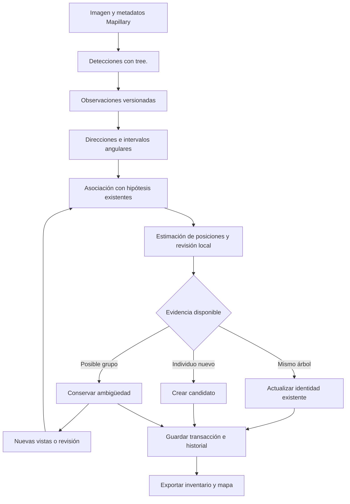

# Plan revisado: inventario de árboles con identidad y evidencia de múltiples vistas

Este documento revisa [PLAN.md](PLAN.md) a partir del código existente, la
captura de Mapillary `870050853581010` y la comparación de textos realizada.
Describe la propuesta de implementación. La primera versión está implementada
en `mapeo/` y `mapear_arboles.py`; uso, resultados y límites de validación en
[GUIA_MAPEO.md](GUIA_MAPEO.md). La validación de una cuadra real sigue pendiente.

## 1. Objetivo y decisiones de partida

Construir progresivamente un inventario de árboles físicos que permita:

- Reconocer nuevas observaciones de un árbol existente sin volver a contarlo.
- Incorporar árboles diferentes aunque estén muy cerca o sus posiciones
  estimadas coincidan dentro del error de localización.
- Corregir una hipótesis que representaba varios árboles agrupados cuando
  nuevas vistas permitan distinguirlos.
- Deshacer fusiones y divisiones incorrectas conservando las observaciones.
- Mostrar en el mapa la evidencia, la incertidumbre y los casos pendientes.

Se mantiene Grounding DINO Tiny con `prompt="tree."`, `threshold=0.35` y
`text_threshold=0.25`. Los cambios de detector, resolución, recortes o umbrales
serán experimentos separados y versionados, no cambios silenciosos del inventario.

La unidad a inventariar es el ejemplar físico. Un árbol con varias ramas o
varios fustes no se convierte automáticamente en varios ejemplares.

**Regla principal: una detección, una coordenada y un árbol son entidades distintas.**

## 2. Qué conservar y qué corregir del plan original

Se conserva la organización conceptual: adquisición, detección, geometría,
asociación y exportación. Se reutilizan los scripts actuales y sus archivos.

| Elemento original | Problema | Revisión |
|---|---|---|
| Desplazar el GPS 5 m hacia una vereda | Todas las detecciones del mismo lado y foto reciben el mismo punto; se pierde la dirección al objeto | Crear observaciones direccionales y estimar posiciones con varias capturas |
| FOV de 90° cuando faltan parámetros | Produce geometría aparentemente precisa con una calibración inventada | Marcar geometría insuficiente; conservar la detección pendiente |
| Ángulo pinhole lineal en el píxel horizontal | No representa correctamente la proyección en perspectiva | Desproyectar con el modelo de cámara y su distorsión |
| Centro de caja como punto exacto del árbol | Cambia cuando la copa aparece parcialmente o agrupa varios ejemplares | Guardar intervalo angular; usar un ancla verificable cuando exista |
| Vecino más cercano a menos de 4 m | Puede fusionar ejemplares próximos y absorber nuevas detecciones | Asociación conjunta por captura, compatibilidad geométrica y restricciones de identidad |
| Supuesto de que nearest-neighbor evita siempre el encadenamiento | El resultado sigue dependiendo del orden y de cómo se actualice el centro | Revisar asociaciones locales y conservar las decisiones para poder corregirlas |
| Confirmar al llegar a dos observaciones | Pueden ser duplicados de una foto o vistas desde la misma posición | Comprobar capturas, separación de puntos de vista y calidad de la evidencia |
| Izquierda/derecha respecto del heading como vereda permanente | El heading de cámara no define necesariamente el sentido de la calle | Usar lado como contexto opcional, referido a un tramo de calle orientado |
| `computed_compass_angle or compass_angle` | Descarta un rumbo válido de 0° | Seleccionar por ausencia explícita (`None`), no por valor booleano |
| Inventario reconstruido como lista JSON | Dificulta reanudar, conservar IDs y corregir asociaciones | Persistencia transaccional; JSON y GeoJSON como exportaciones |
| Score promedio mostrado como porcentaje de confianza | El score del detector no mide certeza de identidad o de posición | Registrar por separado score de detección, asociación y calidad geométrica |
| Descarga fija de una imagen cada 8 m | Puede quitar vistas útiles para separar árboles | Seleccionar según cobertura, calidad y geometría; calibrar el muestreo |

### Evidencia del proyecto actual

La captura de prueba tiene cinco cajas con `tree.`. Cuatro centros están en
la mitad derecha de la imagen. El desplazamiento fijo del plan original
colocaría esas cuatro observaciones en una misma coordenada artificial.

Eso no demuestra cuántos árboles hay: entre las cajas del fondo hay una caja
amplia y cajas menores superpuestas. Primero hay que distinguir duplicados,
grupos e individuos.

Como comprobación de la aproximación angular original: para un FOV de 80° y
un punto al 75 % del ancho, la aproximación lineal da 20°; un pinhole ideal
da aproximadamente 22.76°. La afirmación general de error menor al 5 % no
sirve como garantía.

La imagen es `perspective`, no un panorama 360°. Su tamaño original declarado
es 3264 × 2448 y el archivo analizado mide 2048 × 1536. La captura es del
19 de octubre de 2018: el primer inventario será histórico para ese relevamiento,
no una afirmación sobre los árboles existentes hoy.

## 3. Arquitectura propuesta



La asociación y la localización se revisan juntas: no exigir una coordenada
exacta para empezar a asociar observaciones, ni considerar correcta una
asociación solo porque dos rayos se cruzan.

## 4. Modelo de datos persistente

Usar SQLite inicialmente. No hace falta un servidor de base de datos.
Guardar coordenadas de cálculo en un sistema local en metros y exportar
geometrías a WGS84, con el orden GeoJSON `[longitud, latitud]`.

| Registro | Información mínima |
|---|---|
| Relevamiento | Zona, intervalo de fechas, CRS y configuración de asociación |
| Captura | ID Mapillary, secuencia, fecha, archivo/hash, posición y pose disponibles, procedencia de cada dato |
| Vista derivada | Captura original, recorte o perspectiva, resolución y transformación a la captura |
| Ejecución de detección | ID, revisión del modelo, prompt, umbrales, preprocesado y hash de entrada |
| Observación | ID, ejecución, captura/vista, caja, score, recorte, ancla opcional, intervalo angular y calidad |
| Hipótesis de árbol | UUID estable, estado de identidad, estado de posición, coordenadas opcionales e incertidumbre estimada |
| Grupo no resuelto | Observaciones que podrían contener varios individuos; miembros candidatos y evidencia de separación |
| Asociación | Observación, árbol o grupo, tipo de relación, costo, decisión y versión |
| Evento | Creación, actualización, fusión, división, rechazo o corrección; IDs afectados y motivo |

Una observación puede respaldar un grupo sin respaldar individualmente a cada
miembro. Esa observación no se replica como varias confirmaciones independientes.

### Dos estados separados por árbol

- Identidad: `candidate`, `confirmed`, `needs_review`, `rejected`, `superseded`.
- Posición: `unlocated`, `estimated`, `needs_review`.

Puede saberse que hay dos individuos sin poder separarlos geográficamente
con precisión. Sus IDs serán diferentes; su posición puede seguir pendiente
o tener regiones de incertidumbre solapadas.

### IDs y reanudación

- La coordenada nunca será una clave única de árbol.
- Un ID de observación no es un ID de árbol. Los IDs actuales basados en orden
  de detección quedan como referencias del resultado original, no como UUIDs
  persistentes del inventario.
- Identificar ejecuciones por imagen, modelo/revisión y configuración. La misma
  ejecución importada otra vez no añade observaciones ni aumenta conteos.
- Al activar resultados nuevos para una imagen, desactivar su versión anterior
  para la asociación corriente, conservándola en el historial.
- Recortes y perspectivas del mismo panorama comparten la captura y el centro
  de cámara: no son distintos puntos de triangulación.
- Guardar cada actualización en una transacción. Exportar después del commit.

## 5. Adquisición y preparación

Partir de `mapillary_arboles.py`, no reescribir la integración ya disponible.

1. Obtener imágenes de la secuencia de referencia `NJ3FOf5KSUix2TaldBz7Jw`
   y, si corresponde, otras capturas cercanas del mismo relevamiento.
2. Seleccionar inicialmente entre 10 y 30 capturas útiles de una cuadra;
   comprobar cobertura antes de fijar una cantidad final.
3. Ordenar por `captured_at` dentro de cada secuencia, no por ID ni por orden
   arbitrario de la respuesta de la API.
4. Conservar metadatos originales y calculados. No sustituirlos silenciosamente.
5. Guardar dimensiones reales del archivo descargado, orientación EXIF y cualquier
   transformación aplicada; comprobar si la miniatura está rotada o recortada.
6. Normalizar modelos de cámara: Mapillary usa `spherical` para cámara esférica;
   comprobar la representación de la imagen en lugar de esperar solamente el
   nombre `equirectangular` del plan original.
7. Mantener observaciones de imágenes con geometría incompleta, marcándolas
   como no aptas para triangulación automática.

No unir automáticamente recorridos de años distintos. Introducir luego vigencia
temporal para distinguir persistencia, retirada y reemplazo de árboles en un lugar.

## 6. Geometría: del píxel a una dirección y de varias vistas a una posición

### 6.1 Validar el modelo de cámara

Crear adaptadores por modelo, empezando por `perspective`.
Comprobar las convenciones de Mapillary/OpenSfM antes de usar `computed_rotation`:
sentido de la rotación, ejes y marco de referencia. No interpretarlo directamente
como tres ángulos yaw/pitch/roll ni sumar el heading dos veces.

Para perspectiva sin distorsión ni rotaciones fuera del plano horizontal,
el caso de control es:

```text
ángulo relativo = atan((u - cx) / fx)
```

En producción: convertir el píxel en un rayo según la cámara, corregir la
distorsión y transformar el rayo al marco de trabajo. Escalar intrínsecos
si cambió la resolución; incorporar la transformación si hubo recortes o
rotación. El FOV sirve para comprobaciones, no sustituye la calibración.

OpenSfM normaliza las coordenadas respecto de la dimensión mayor de la imagen;
Mapillary documenta `[focal, k1, k2]` para perspectiva. Usar ambas convenciones
de forma consistente. Referencias: [geometría de OpenSfM](https://opensfm.org/docs/geometry.html)
y [datos de cámara de Mapillary](https://mapillary.github.io/mapillary-js/api/interfaces/api.SpatialImageEnt/).

Para `spherical`, verificar la orientación y las uniones del panorama antes
de habilitarlo. Cualquier vista en perspectiva derivada conservará su pose
relativa al panorama original. Fisheye queda pendiente hasta tener un adaptador
validado; no se tratará como pinhole.

### 6.2 Representar lo que una caja realmente permite inferir

El centro de una caja sobre una copa no es un punto físico estable.
Guardar como mínimo el intervalo de direcciones compatible con la caja.

Si puede identificarse el tronco o un ancla consistente, guardar su posición
en píxeles, método de obtención y calidad. El centro inferior de la caja no
se considera automáticamente la base del tronco, especialmente con autos u
otras oclusiones. Para validar el primer prototipo se admiten anclas manuales
en una muestra pequeña, diferenciadas de las obtenidas automáticamente.

Una observación sin distancia ni otra restricción fiable produce una dirección
o región de posibilidades. No se coloca un punto a 5 m para simular una medición.

### 6.3 Localización con múltiples capturas

- Generar candidatos de correspondencia entre capturas próximas del relevamiento.
- Estimar posiciones en planta usando direcciones compatibles hacia un mismo
  punto físico. La primera versión no necesita reconstruir toda la calle en 3D.
- Con anclas fiables, ajustar un punto con un método robusto que reduzca el efecto
  de observaciones erróneas; con intervalos amplios, conservar regiones y ambigüedad.
- Exigir desplazamiento de cámara y una geometría útil. Rayos casi paralelos,
  cruces detrás de la cámara y asociaciones incompatibles quedan pendientes.
- Revisar residuos angulares, consistencia entre vistas y sensibilidad a errores
  de cámara; rechazar localizaciones inestables aunque exista una intersección.
- Registrar incertidumbre y sus supuestos. Los errores de una misma secuencia
  pueden estar correlacionados: varias fotos no equivalen a varios GPS independientes.
- Separar calidad relativa entre árboles y exactitud absoluta sobre el mapa.
  No reportar precisión centimétrica ni intervalos estadísticos sin validación.

Los umbrales de geometría se calibran con pruebas sintéticas y una muestra real;
no reemplazar el antiguo radio de 4 m por otra constante supuestamente universal.

## 7. Asociación y prevención del doble conteo

### 7.1 Resolver cada captura como conjunto

Antes de asociar con el inventario, detectar posibles duplicados y cajas que
abarcan otras. La superposición sola no determina si son el mismo árbol:
dos individuos distintos pueden tener copas superpuestas.

Clasificar relaciones como duplicado probable, individuos separables o grupo
ambiguo. Conservar evidencia y no suprimir automáticamente cajas cercanas.
Usar la captura de prueba como regresión: sus cinco cajas no son cinco IDs
confirmados por defecto.

### 7.2 Asociación con el inventario

Para observaciones consideradas individuales, construir candidatos usando:

- Consistencia de la dirección observada con la ubicación o región del árbol.
- Error de reproyección angular, ancla disponible y geometría de las vistas.
- Incertidumbre de ambas estimaciones y contexto temporal/espacial.
- Apariencia como señal auxiliar; árboles similares no se identifican por
  parecido visual únicamente.

Resolver la asignación conjuntamente por captura. Después de resolver duplicados,
dos observaciones de individuos comprobablemente diferentes no se asignan a la
misma identidad. Una formulación de asignación bipartita permite controlar esa
restricción; debe incluir opciones de no asignación, nuevo candidato y revisión,
sin forzar una correspondencia mala. Referencia de implementación:
[SciPy linear_sum_assignment](https://docs.scipy.org/doc/scipy/reference/generated/scipy.optimize.linear_sum_assignment.html).

Las observaciones de grupos van por una relación de grupo, no se fuerzan a esta
asignación uno a uno. Si varios árboles son igualmente compatibles, conservar
alternativas sin decidir por una diferencia mínima de costo.

La distancia geográfica sirve para recuperar candidatos de búsqueda. No es
por sí sola una regla para fusionar. Lo mismo aplica a izquierda/derecha:
se usa como contexto de una calle orientada, no como identidad global.

### 7.3 Revisión local

Cada captura nueva permite reexaminar árboles y grupos de su entorno. El orden
de llegada no debe congelar una mala primera decisión. Una pasada de reconciliación
al final del lote revisará asociaciones locales; los casos irresolubles seguirán
en revisión. Registrar cualquier dependencia residual del orden de procesamiento.

## 8. Corregir un registro que representaba varios árboles

Esta operación es parte central del inventario, no un agregado posterior.

### Escenario A: hipótesis anterior ambigua

1. La captura inicial contiene una caja amplia: se crea la hipótesis provisional
   `A`, conservando la posibilidad de un grupo. No se declara automáticamente
   que sea un único árbol confirmado.
2. Nuevas capturas muestran dos candidatos separados, `B` y `C`.
3. Verificar que no sean cajas duplicadas o ramas del mismo ejemplar. Buscar
   evidencia repetida de separación y correspondencias geométricas consistentes;
   permitir revisión manual si no se resuelve automáticamente.
4. Si se acepta la división, en una transacción: crear `B` y `C`, marcar `A`
   como `superseded`, y guardar el evento `split(A -> B, C)`.
5. Mantener la caja amplia inicial como evidencia del grupo. No inventar dos
   anclas ni copiarla como confirmación independiente de ambos individuos.
6. Exportar solamente los registros activos. Si el conteo provisional anterior
   era uno, la sustitución por dos debe dar dos, no tres. El contador de
   confirmados se calcula según el estado real de los hijos.

### Escenario B: árbol anterior bien identificado y vecino recién descubierto

Si existe evidencia suficiente de que `A` corresponde a uno de los dos árboles,
conservar su UUID y agregar solamente el vecino `B`. Registrar por qué se
conservó la correspondencia; no reasignar el ID arbitrariamente al más cercano.

### Escenario C: dos árboles con coordenadas estimadas coincidentes

Si las vistas permiten distinguir dos individuos, conservar dos IDs aunque el
GPS, la precisión o el redondeo no permitan separarlos en el mapa. Marcar la
limitación de posición. Dos puntos iguales no implican dos árboles, y tampoco
implican que deba existir solo uno: la decisión depende de la evidencia.

### Escenario D: una vista posterior vuelve a agruparlos

Una caja amplia que contiene a `B` y `C` no vuelve a fusionarlos. Se incorpora
como observación ambigua del grupo y no aumenta el conteo de individuos.

### Operación inversa

Si dos IDs resultan ser el mismo árbol, permitir una fusión respaldada por
evidencia, conservar un UUID canónico y marcar el otro como reemplazado.
Registrar `merge`, asociaciones afectadas y reversión. Ni fusiones ni divisiones
se disparan solo por cercanía, por dos cajas o por el paso de un umbral de score.

**Límite:** si ninguna imagen separa visual o geométricamente los ejemplares,
el mapeo no puede recuperar de manera fiable cuántos hay. El grupo queda pendiente.

## 9. Conteos y visualización

Publicar contadores separados de:

- Árboles con identidad confirmada, activos en el relevamiento.
- De ellos, árboles con posición estimada y árboles aún sin ubicación suficiente.
- Candidatos individuales y grupos no resueltos, sin sumarlos automáticamente
  al total confirmado.
- Observaciones procesadas, duplicados descartados y casos para revisión.

No mantener el total sumando cada detección recibida. Calcularlo desde las
entidades activas y sus estados, después de cada transacción.

Exportaciones previstas:

- `arboles.geojson`: individuos activos con posición; estado, incertidumbre e IDs.
- `observaciones.geojson`: evidencia y vínculos a capturas; geometría nula si no
  hay localización, o direcciones de observación claramente identificadas.
- `camaras.geojson`: posiciones de captura; capa distinta de los árboles.
- `grupos.geojson`: regiones de incertidumbre representables; geometría nula si
  no existe una región finita justificada. Sin puntos centrales ficticios.
- `inventario.json`: incluye entidades sin ubicación, historial y referencias.
- `mapa.html`: vista local de revisión con capas, recortes y enlaces a Mapillary.

El mapa tendrá filtros por relevamiento/fecha y distinguirá individuos, grupos,
cámaras e incertidumbre. Si dos puntos coinciden visualmente, permitir desplegar
sus registros sin modificar sus coordenadas para simular una separación.

Primero exportar un mapa local después de cada imagen/lote confirmado en base
de datos. Una actualización continua en un navegador puede añadirse después;
no es requisito para validar la asociación.

## 10. Organización de implementación

Mantener las entradas actuales y agregar módulos importables, evitando duplicar
la adquisición y la inferencia en archivos numerados.

```text
agrotech/
  mapillary_arboles.py       # Adquisición existente y entrada del procesamiento
  detectar_arboles.py        # Inferencia existente con tree.
  mapeo/
    almacen.py              # SQLite, migraciones, ejecuciones y eventos
    camaras.py              # Calibración, vistas y desproyección
    observaciones.py        # Importación y relaciones dentro de una captura
    asociacion.py           # Candidatos, asignación y grupos
    localizacion.py         # Ajuste geométrico y calidad de posición
    inventario.py           # Estados, fusiones, divisiones y conteos
    exportacion.py          # GeoJSON y mapa local
  mapear_arboles.py          # Orquestación y reanudación del inventario
  configuracion_mapeo.json   # Parámetros versionados, sin credenciales
  resultados/mapeo/
    inventario.sqlite
    exportaciones/
  tests/
    test_mapillary.py        # Pruebas existentes
    test_camaras.py
    test_asociacion.py
    test_inventario.py
```

Reutilizar dependencias actuales. Agregar según el hito: NumPy/SciPy para
geometría y asignación, pyproj para coordenadas y Folium para el mapa local.
SQLite y configuración JSON usan la biblioteca estándar. Validar y fijar versiones
compatibles en `hackaton` al implementar; no instalar nada durante esta planificación.

Fuentes: [transformaciones con pyproj](https://pyproj4.github.io/pyproj/stable/api/transformer.html)
y [visualización con Folium](https://python-visualization.github.io/folium/latest/).

Mantener el token en la configuración local ignorada existente. No trasladarlo
a un YAML ni a las exportaciones.

## 11. Hitos con criterios de aceptación

| Hito | Trabajo | Condición para avanzar |
|---|---|---|
| 0. Base reproducible | Registrar prompt/umbrales, revisión del modelo y casos de referencia | `tree.` conservado; comparación previa enlazada; una captura sola no se presenta como inventario localizado |
| 1. Persistencia | SQLite e importación de manifest/detecciones existentes | Importar dos veces no duplica observaciones ni entidades; reanudar tras interrupción conserva IDs |
| 2. Cámaras | Adaptador de perspectiva, transformaciones y control de orientación | Pruebas de desproyección/reproyección y anclas verificadas; metadata insuficiente queda pendiente |
| 3. Asociación y localización | Direcciones, candidatos, asignación por captura y ajuste robusto | En escenas sintéticas el mismo árbol conserva identidad y vecinos distintos no se fusionan por radio |
| 4. Grupos y correcciones | Relaciones ambiguas, split/merge y revisión local | Casos uno-a-dos y dos-a-uno transaccionales, reversibles y sin conteos acumulados |
| 5. Mapa local | Exportaciones, capas, evidencia e incertidumbre | Árboles, cámaras y grupos diferenciados; inventario vacío y entidades sin ubicación se manejan |
| 6. Validación de la cuadra | Varias capturas reales de la zona elegida y anotación manual | Informe de duplicados, fusiones falsas, separaciones falsas, omisiones y errores de ubicación |

La calibración geométrica y los casos de identidad se validan antes de escalar
a muchas cuadras. El aspecto del mapa no es el criterio para aceptar el conteo.

## 12. Pruebas necesarias

1. Mismo árbol en tres capturas desde posiciones útiles: un ID activo.
2. Misma imagen o mismo manifest procesados dos veces: ningún incremento.
3. Resultado de detección revisado: una sola versión activa por captura/vista.
4. Varias perspectivas del mismo panorama: no aportan triangulación independiente.
5. Dos individuos separados por menos de 4 m: no se fusionan por esa cercanía.
6. Grupo provisional que luego se separa: sustitución uno-a-dos, nunca uno más dos.
7. Árbol existente identificable y vecino nuevo: conservar ID y añadir solo el vecino.
8. Dos individuos con posiciones inciertas solapadas: conservar identidades cuando
   exista evidencia de separación, manteniendo la limitación geográfica.
9. Dos cajas solapadas del mismo individuo: no crear dos árboles confirmados.
10. Una caja amplia después de haber confirmado dos individuos: no fusionarlos.
11. Rayos casi paralelos, anclas incoherentes y GPS/orientación incorrectos:
    rechazar la localización automática o enviarla a revisión.
12. Heading de 0°, cambio de resolución, EXIF y distorsión: geometría coherente.
13. Cámara mirando hacia atrás o cambio de sentido: lado de imagen no impone
    una vereda global incorrecta.
14. Árbol que sale de cuadro y reaparece: intentar recuperar la identidad;
    no eliminarlo ni crear otro solo por una ausencia temporal.
15. Lotes en distinto orden: reconciliar el mismo resultado en casos controlados;
    reportar ambigüedades y no depender de un nearest-neighbor irreversible.
16. Capturas de años distintos: conservar relevamientos y cambios temporales.
17. Split/merge interrumpido: rollback sin IDs huérfanos ni doble conteo.
18. Inventario vacío: exportaciones válidas sin división por cero.

El COCO actual permite evaluar detección en imagen. Para evaluar identidad y
geolocalización hace falta una muestra adicional que enlace el mismo ejemplar
entre capturas y, para error absoluto, posiciones de referencia verificadas.
Medir error por árbol asociado correctamente, no distancia al vecino más cercano.

## 13. Alcance de la primera versión

La primera versión deberá demostrar, en una cuadra, importación reproducible,
asociación de múltiples vistas, posiciones justificadas o pendientes, y una
división respaldada por evidencia con conteo correcto. Tendrá revisión manual
para casos irresolubles y no prometerá resolver toda copa superpuesta.

Quedan para después: identificación de especies, reconstrucción completa 3D,
segmentación avanzada, precisión topográfica, cobertura de toda una ciudad y
actualización temporal automática de árboles retirados o reemplazados.

Resultado esperado: un inventario explicable y corregible, donde se pueda abrir
cada árbol o grupo y consultar qué capturas justifican su identidad y posición.
